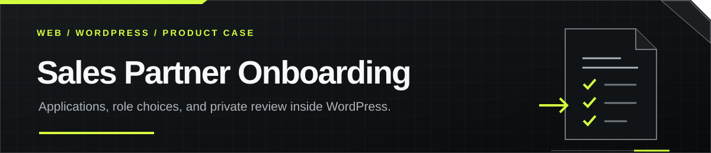
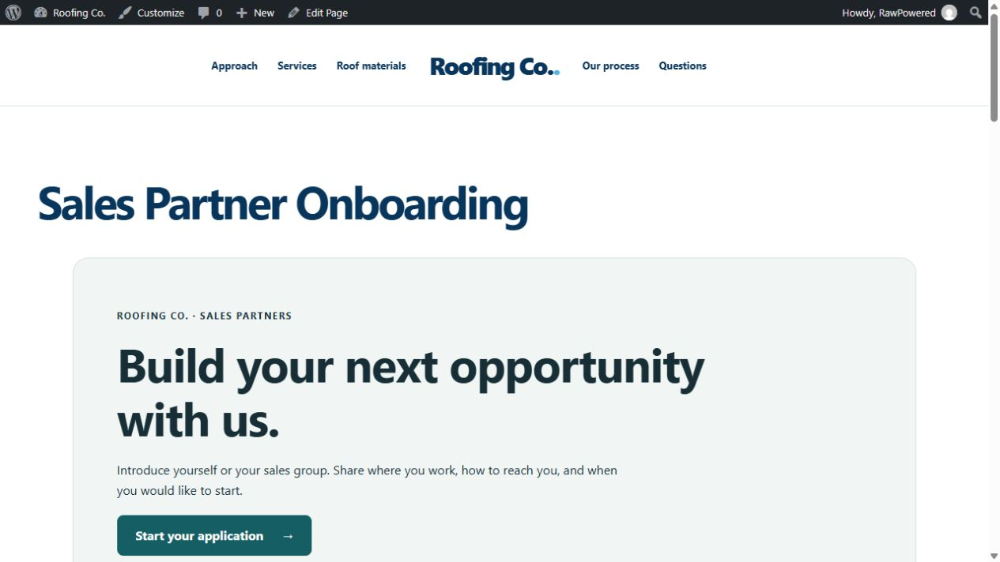
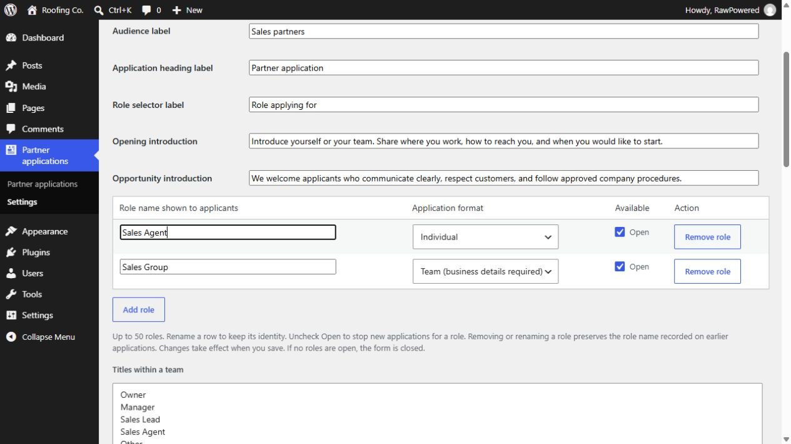
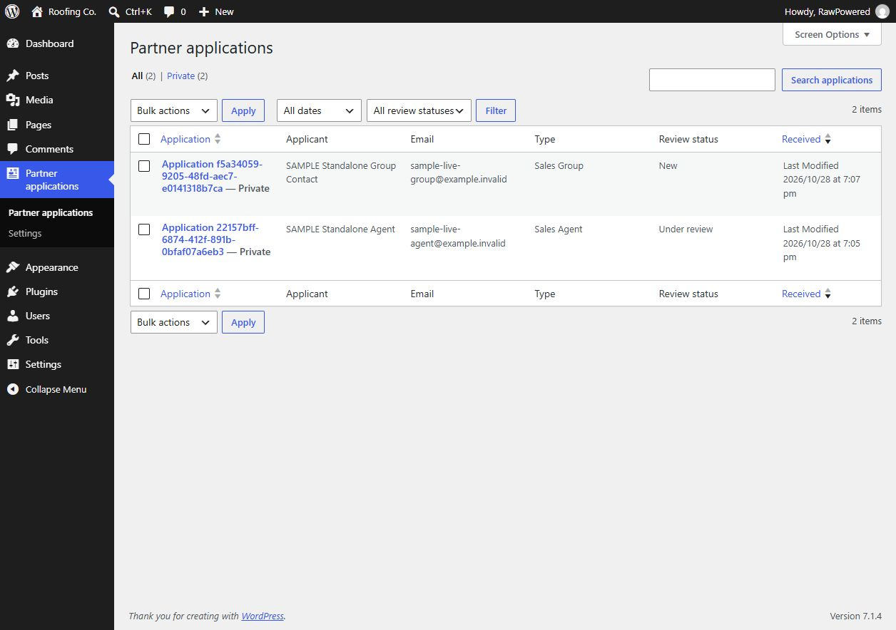
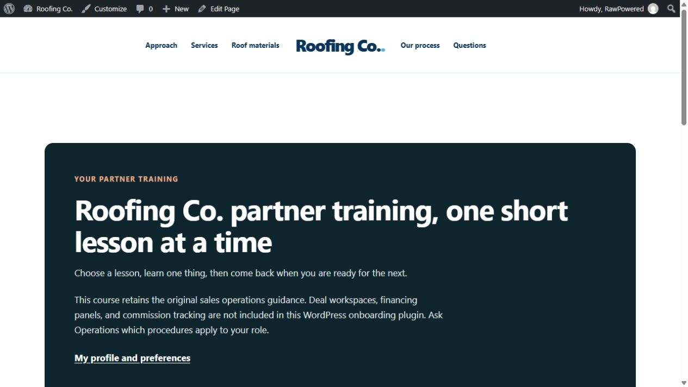
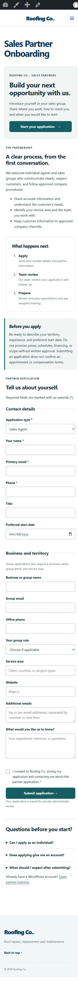

  

<strong>THE FIRST SCREEN / WORDPRESS APPLICATION INTAKE</strong>

  

<strong>CONFIGURABLE ROLES / PRIVATE ADMINISTRATOR REVIEW</strong>

  
  

<strong>100 recorded runtime and HTTP checks · configurable application roles · no CRM required</strong>

<a href="#the-application-journey">Explore the workflow</a> · <a href="#verification-evidence">Inspect the evidence</a> · <a href="resources/document-templates/README.md">Get the free PDF templates</a>

# Sales Partner Onboarding

Sales Partner Onboarding is a standalone WordPress plugin for collecting individual and team applications, recording consent, and keeping administrator review in the same site. Companies can change application wording, add roles, choose an individual or team format, and close roles as their needs change.

The project began as an extraction of an existing PowerPortals onboarding experience. Its intake, settings, private records, optional acknowledgements, and account-based training now run without the original platform or a CRM connection.

This showcase presents the product, interaction design, screenshots, free document worksheets, and dated verification evidence. Plugin source and installable packages are maintained in a separate private repository.

## What the product supports

- Applications for individual roles and teams, with server-enforced contact and business-field requirements.
- Company identity, accent color, privacy link, contact route, introductions, confirmation wording, and configurable role labels.
- Up to 50 application roles, each with its own displayed name, availability, and Individual or Team format.
- Optional titles within a team, such as Owner, Manager, or a company-defined title.
- A private administrator inbox with search, review-status filtering, internal notes, and review history.
- Consent receipts and duplicate protection that remain available when optional email notifications fail.
- An optional company-wide PDF acknowledgement flow with explicit document versions and file-integrity checks.
- A copied six-lesson course, resources, server-graded assessment, and internal completion certificate on existing WordPress accounts.

Application role choices describe positions people can apply for. They do not create WordPress user roles, provision accounts, or grant permissions. Historical applications keep the role name recorded when the person applied.

## Technology

<table>
  <tr>
    <td align="center" width="50%"> <strong>PHP 8.0+</strong> Validation, receipts, review logic, and plugin runtime</td>
    <td align="center" width="50%"> <strong>WordPress 6.4+</strong> Private records, Settings API, capabilities, and shortcodes</td>
  </tr>
  <tr>
    <td align="center"> <strong>HTML5</strong> Semantic forms, native controls, and readable document flows</td>
    <td align="center"> <strong>CSS3</strong> Scoped styles, responsive layouts, and theme compatibility</td>
  </tr>
  <tr>
    <td align="center" colspan="2"> <strong>Vanilla JavaScript</strong> Role editor controls, team-field guidance, and account-based course interactions</td>
  </tr>
</table>

The five technology images are the exact glass icon assets used in the [BlueRoof WP Theme showcase](https://github.com/RawPowered/BlueRoof-WP-Theme-Showcase). Their source revision and file hashes are recorded in [asset provenance](assets/icons/BLUEROOF-REFERENCE.json). The application form also submits without JavaScript; the server enforces its requirements.

## The application journey

| Step | Applicant experience | WordPress behavior |
| --- | --- | --- |
| Discover | Read the company introduction, expectations, and next steps | Render a shortcode on a dedicated onboarding page |
| Choose | Select an open role | Show only available application choices |
| Apply | Enter contact details and any required team information | Validate input and persist a private application |
| Acknowledge, if enabled | Read the configured PDF and complete the required commitments | Save document version/hash and the acknowledgement receipt |
| Confirm | See a generic acknowledgement of receipt | Keep private application data out of the public confirmation |
| Review | Receive next-step contact from the company | Let administrators search, add notes, and update review status |
| Prepare | Read assigned training using an existing account | Save progress and assessment results to that WordPress account |

The company controls its own review process. Submitting an application, changing its review status, or completing training does not automatically grant access to other systems.

## Configurable words and roles

The native **Wording and roles** screen lets administrators edit the audience label, application heading label, role selector label, and two introductions. The role table supports adding, renaming, removing, or closing choices without changing account permissions.

Each choice has an application format. Individual applications require the ordinary contact details. Team applications also require a business/team name, team email, and service area. This distinction drives the browser guidance and is checked again by the server.

Role identity stays stable when a name changes. New receipts preserve the displayed name and format at submission; older records preserve their original wording. Closed, removed, or unknown roles are rejected for new submissions, including forms left open before settings changed. Removing all available roles closes the form.

WordPress page titles and course lesson content are managed separately from the application-wording settings.

## Private review and durable records

Applications use private WordPress custom post records and metadata. Only administrators with the required capability can review them. The application post type is excluded from public queries, search, and its own public REST collection.

The inbox tracks **New**, **Under review**, **Approved**, **Declined**, and **Archived** states. Review notes and timestamps form a separate history; they do not overwrite the submitted receipt. Duplicate requests with the same identifier and data reuse the saved record and do not resend a notification.

Optional administrator notifications use the site's WordPress mail transport and contain a private review link. A failed notification leaves the application in WordPress. A successful transport call is not evidence that an email reached an inbox. Notifications were disabled during live synthetic intake tests.

The WordPress privacy tools can export matching application/receipt data and account training. Training data can be erased through that workflow; applications and acknowledgement receipts report retention pending an administrator's review. Deactivation preserves records and settings.

## Custom PDF acknowledgements

The optional PDF is one public, company-wide document shared by all application roles. Applicants read that template and enter their acknowledgement in a separate WordPress form. The plugin does not populate, stamp, or generate a signed PDF.

An administrator selects a local Media Library PDF up to 10 MB and assigns an explicit approved version. The form records the document's attachment ID, URL, version, and SHA-256 hash, together with the required legal name, matching typed signature, consent, commitments, and timestamp. File changes and stale document hashes block new acknowledgements until the document/version setup is repaired.

The plugin does not verify signer identity, make a public template confidential, or create an immutable archive of every approved original. Companies retain those originals separately and define their own document and retention procedures. The current workflow has seven fixed commitments; changing the PDF text does not change those checkboxes.

Read the [complete PDF setup and receipt guide](docs/custom-pdf-guide.md) for configuration, replacement, failure recovery, and scope limits.

### Free generic worksheets

| Starting point | Blank PDF | Editable source |
| --- | --- | --- |
| Role onboarding overview | [PDF](resources/document-templates/pdf/role-onboarding-overview.pdf) | [Markdown](resources/document-templates/sources/role-onboarding-overview.md) |
| Partner expectations and commitments | [PDF](resources/document-templates/pdf/partner-expectations-and-commitments.pdf) | [Markdown](resources/document-templates/sources/partner-expectations-and-commitments.md) |
| Team onboarding supplement | [PDF](resources/document-templates/pdf/team-onboarding-supplement.pdf) | [Markdown](resources/document-templates/sources/team-onboarding-supplement.md) |

**These generic templates have not been reviewed by a legal representative. They are not legal advice or production-ready agreements. Have a qualified legal representative review and adapt them for your organization and jurisdiction before live production use.**

The three original worksheet PDFs and matching sources are free to repurpose under [CC0 1.0 Universal](resources/document-templates/LICENSE-TEMPLATES.txt). That dedication is limited to those generic templates; it does not relicense the plugin code, portfolio assets, company branding, or later company documents.

## Training and preparation

The optional course keeps six lessons, a FAQ/resource guide, a mixed-format 12-question assessment, and a printable internal completion certificate. Progress, resource visits, the last ten score-only assessment attempts, and certificates are stored on an existing signed-in WordPress account. Passing requires all lessons and at least 10 correct answers.

The copied operational lessons include topics such as workspaces, record keeping, financing boundaries, commission status, and customer handoffs. Those lessons are guidance; the plugin does not implement a deal portal, bank connection, or commission system. Company-specific Operations readiness checks remain unverified until reviewed. Certification stays closed until the configured provider-procedure readiness check is verified.

  

## Responsive layouts

The application layout was checked locally at 320, 390, 768, and 1440 pixels and on the hosted test installation at 320, 390, and 768 pixels. The recorded checks found no horizontal overflow. Inputs, team guidance, confirmations, and ordinary form submission were checked alongside the desktop administrator workflow.

Open the full mobile application capture

The dated screenshots show genuine test-site views, including the WordPress administrator toolbar. Visible application records are explicitly labeled synthetic examples. They are evidence captures, not a claim that every current setting appears in each earlier image.

## Verification evidence

The project recorded **100 runtime and HTTP checks** on October 28, 2026:

| Evidence | Recorded checks | Coverage |
| --- | ---: | --- |
| [Core runtime](evidence/2026-10-28/local-runtime.json) | 51 | Validation, private storage, consent, agreement drift, duplicate protection, failed-mail persistence, review controls, permissions, privacy, and independent operation |
| [Role configuration](evidence/2026-10-28/roles-runtime.json) | 27 | New roles, renaming, stable identity, historical labels, format requirements, disabled choices, malformed input, and unchanged WordPress user roles |
| [Actual HTTP requests](evidence/2026-10-28/local-http.json) | 22 | JavaScript-free submission, nonce checks, private API exclusion, course access, progress, server grading, certificates, and replay protections |

Separate [responsive evidence](evidence/2026-10-28/responsive.json) and [unauthenticated hosted HTTP checks](evidence/2026-10-28/live-public-http.json) record layout widths, a public form response, private-record/API denial, and the training login redirect.

Standalone intake was demonstrated on local SolHydrix and a hosted WordPress 7.1.4 test installation where this was the sole active plugin. Individual, team, and a temporary custom-role submission reached the private inbox. The temporary role was removed after testing, and its saved application retained the original role name.

These are dated functional checks, not Lighthouse scores, a security certification, a legal review, or a claim of actual email delivery. Full assessment grading used a disposable local account; the live administrator's training history was not changed for that test.

## Project status

| Milestone | Status |
| --- | --- |
| Standalone WordPress intake and private review | Implemented and checked locally/hosted |
| Configurable words and application roles | Implemented and checked in `0.2.0` |
| Generic PDF worksheets, guide, and settings help | Prepared in `0.2.1`; PDFs rendered and inspected, package PHP syntax checked |
| Hosted installation | Last deployed test build: `0.2.0` |
| CRM/API connectors | Deferred |
| Production company setup | Company content, privacy/retention, any approved agreement, notification delivery, and training procedures require review/configuration |

No page builder, original PowerPortals installation, or CRM credential is required for intake. The plugin uses WordPress's ordinary plugin, form, settings, record, and user facilities.

## Scope and next steps

Zoho, custom REST delivery, OAuth, external API access, record mapping, and CRM queues are deferred. The current milestone is a complete local WordPress intake/review workflow with optional document and training steps.

Future work should preserve local receipt storage and independent operation when optional connections are unavailable. No connector support is advertised as implemented or certified here.

## Documentation and contact

- [Custom PDF setup and receipt guide](docs/custom-pdf-guide.md)
- [Generic PDF templates and editable sources](resources/document-templates/README.md)
- [Dated verification notes](evidence/2026-10-28/README.md)
- [Technology icon provenance](assets/icons/BLUEROOF-REFERENCE.json)
- [Publication review](evidence/2026-10-28/publication-review.md)
- [Rights and template reuse](RIGHTS.md)
- [Joseph Edwards on GitHub](https://github.com/RawPowered)

Design and development by [Joseph Edwards](https://github.com/RawPowered). This case study follows the BlueRoof showcase's charcoal/lime visual system and reuses its exact glass code icons. Plugin implementation is maintained privately. Portfolio material does not grant a general reuse license; the generic template subtree has its own explicit CC0 dedication and included third-party notices retain their scope.
